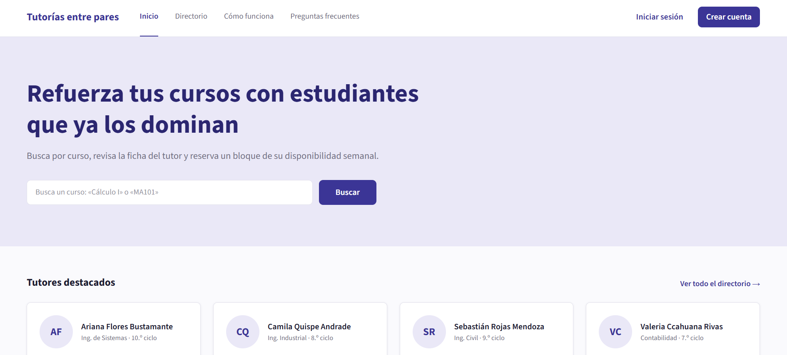
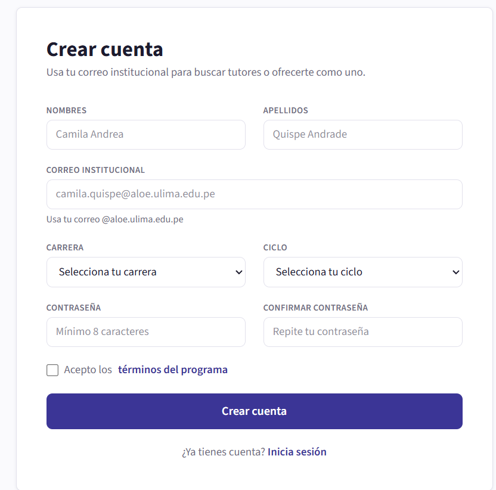
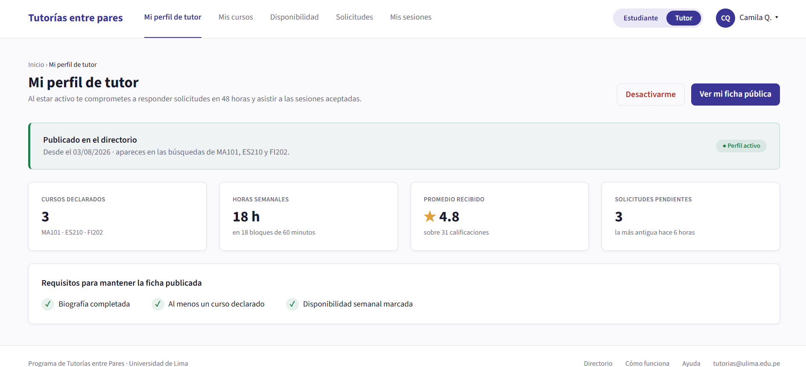
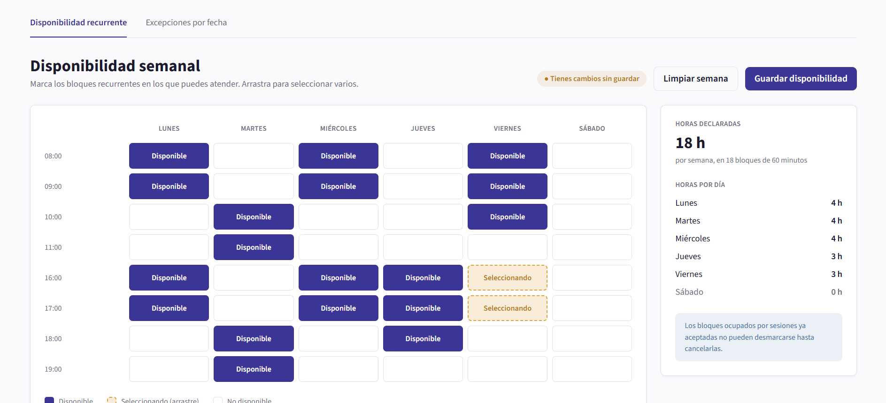

<div align="center">

# 🎓 Tutorías entre pares

**Plataforma que conecta estudiantes que necesitan reforzar un curso con estudiantes que se ofrecen como tutores.**

Programación Web · Universidad de Lima · Tema 4


</div>

---

## 📸 Vista previa

<table>
  <tr>
    <td align="center"><b>Landing pública</b><br></td>
    <td align="center"><b>Registro</b><br></td>
  </tr>
  <tr>
    <td align="center"><b>Mi perfil de tutor</b><br></td>
    <td align="center"><b>Disponibilidad semanal</b><br></td>
  </tr>
</table>

---

## 📋 Avance de la Entrega 1 (solo interfaz)

| Historia | Tema | Responsable | Estado |
| :---: | --- | --- | :---: |
| 1 | Cuenta y acceso | Rodrigo | ✅ Completa |
| 2 | Ficha y disponibilidad del tutor | Rodrigo | ✅ Completa |
| 3 | Directorio de tutores | Gustavo | ✅ Integrada |
| 4 | Agenda de sesiones | Gustavo | ✅ Integrada |
| 5 | Desarrollo y cierre | Juan Diego | ✅ Integrada |
| 6 | Valoraciones | Yahel | ✅ Integrada |
| 7 | Panel del coordinador | Pedro | ✅ Integrada |

> ✅ Completa / integrada · 🚧 En progreso · ⏳ Pendiente

**Las 7 historias están integradas y conectadas entre sí**: los menús y botones llevan a las pantallas de las otras historias (por ejemplo, *Detalle de la sesión* → *Cerrar sesión* de la Historia 5, o *Ver reseñas* → opiniones de la Historia 6).

**Diseño unificado:** todas las vistas comparten la misma cabecera (blanca, 76 px de alto, 56 px de margen, sección activa subrayada; oscura en el panel del coordinador) y el mismo pie (oscuro, 84 px de alto).

<details>
<summary><b>Ver detalle de pantallas y rutas</b></summary>

### Historia 1 · Cuenta y acceso

| Pantalla | Estados incluidos | Ruta |
| --- | --- | --- |
| 1.1 Landing pública | — | `/` |
| 1.2 Inicio de sesión | credenciales incorrectas · cargando | `/login` |
| 1.3 Registro | validación en línea · cuenta creada | `/registro` |
| 1.4 Recuperar contraseña | pasos 1, 2 y 3 | `/recuperar` |
| 1.5 Mi cuenta | — | `/mi-cuenta` |
| 1.6 Errores 403 y 404 | — | `/403` |

### Historia 2 · Ficha y disponibilidad del tutor

| Pantalla | Estados incluidos | Ruta |
| --- | --- | --- |
| 2.1 Mi perfil de tutor | inactivo · ficha incompleta | `/tutor/perfil` |
| 2.2 Mis cursos | estado vacío | `/tutor/cursos` |
| 2.3 Disponibilidad semanal | — | `/tutor/disponibilidad` |
| 2.4 Excepciones por fecha | — | `/tutor/disponibilidad/excepciones` |
| 2.5 Ficha pública del tutor | — | `/tutores/camila-quispe` |

### Historia 3 · Directorio de tutores

| Pantalla | Ruta |
| --- | --- |
| 3.1 Directorio con resultados | `/directorio` |
| 3.2 Detalle del tutor con selección de bloque | `/tutor` |
| 3.3 Tutor sin bloques libres | `/tutor-sin-horarios` |

### Historia 4 · Agenda de sesiones

| Pantalla | Ruta |
| --- | --- |
| 4.1 Modal de solicitud | `/solicitar-sesion` |
| 4.2 Mis sesiones | `/mis-sesiones` |
| 4.3 Solicitudes recibidas | `/solicitudes` |
| 4.4 Modal · proponer horario alternativo | `/proponer-horario` |
| 4.5 Detalle de la sesión | `/detalle-sesion` |

### Historia 5 · Desarrollo y cierre

| Pantalla | Ruta |
| --- | --- |
| 5.1 Cierre de la sesión | `/cierre-sesion` |
| 5.2 Material compartido | `/material-compartido` |
| 5.3 Historial de sesiones | `/historial-sesiones` |
| 5.4 Resumen de horas | `/resumen-horas` |

> En la Historia 5, el conmutador **Estudiante / Tutor** cambia la vista dentro de la misma pantalla.

### Historia 6 · Valoraciones

| Pantalla | Ruta |
| --- | --- |
| 6.1 Calificar al tutor | `/calificar-sesion/:sesionId` · `/editar-calificacion/:id` |
| 6.2 Reseñas del tutor | `/valoraciones-tutor/:tutorId` (ej. `/valoraciones-tutor/camila`) |
| 6.3 Mis calificaciones | `/mis-calificaciones` · `?vista=pendientes` |
| 6.4 Ranking de tutores por curso | `/ranking-tutores` |

> La Historia 6 presenta mockups con datos estáticos: no guarda, edita ni elimina calificaciones. Las estrellas del modal tienen hover visual, el comentario admite escritura sin persistencia y la X vuelve a Mis sesiones. El parámetro `?vista=pendientes` permite revisar la variante vacía del listado.
>
> Ver el [informe de correcciones de interfaz](docs/INFORME_CORRECCIONES.md) para conocer los cambios, las rutas y las verificaciones realizadas.

### Historia 7 · Panel del coordinador

| Pantalla | Ruta |
| --- | --- |
| 7.1 Listado de tutores | `/coordinador/tutores` |
| 7.2 Modal · suspender tutor | `/coordinador/tutores/suspender` |
| 7.3 Gestión de usuarios | `/coordinador/usuarios` |
| 7.4 Tablero de métricas | `/coordinador/tablero` |

</details>

---

## 🚀 Cómo correr el proyecto

```bash
git clone https://github.com/20240497-code/tutorias-entre-pares.git
cd tutorias-entre-pares
npm install
npm run dev
```

Abre **http://localhost:5173/mapa** para ver el índice de todas las pantallas.

---

## 🗂️ Estructura

```
src/
├── App.jsx              rutas de toda la app
├── App.css              Tailwind + colores del sistema de diseño
├── components/
│   ├── compartidos/     headers y footer de las Historias 1 y 2
│   ├── historia1/       modal de cuenta creada
│   ├── historia2/       estado vacío y pestañas de disponibilidad
│   ├── historias3y4/    Comunes.jsx (marco, cabecera, calendario…) de las Historias 3 y 4
│   ├── historia5/       Comunes.jsx + RolCompartido.jsx (rol Estudiante / Tutor)
│   ├── historia6/       Comunes.jsx, Valoraciones.jsx, PestanasDirectorio.jsx + LayoutValoraciones.jsx (interfaz estática)
│   └── historia7/       Compartidos.jsx (cabecera del coordinador) + estilos-h7.css
├── contexto/            ValoracionesContext.jsx (conservado; desconectado de las vistas HU6)
├── datos/               datosHU6.js (Historia 6)
├── servicios/           valoraciones.js (Historia 6)
└── pages/
    ├── MapaRutas.jsx    índice de todas las pantallas
    ├── historia1/       13 páginas
    ├── historia2/       8 páginas
    ├── historia3/       Historia3.jsx (3 pantallas)
    ├── historia4/       Historia4.jsx (5 pantallas)
    ├── historia5/       4 páginas
    ├── historia6/       4 páginas
    └── historia7/       4 páginas
```

---

## 🤝 Reglas para hacer cambios

1. Trabaja solo en `pages/historiaN/` y `components/historiaN/` de tu historia.
2. Las rutas nuevas van en `App.jsx` **antes** de la ruta `*` (404), y su enlace en `pages/MapaRutas.jsx`.
3. Si un botón lleva a otra historia, usa su ruta de las tablas de arriba (por ejemplo, `/directorio` o `/mis-sesiones`).
4. No cambies el estilo de la cabecera ni del pie: es el mismo en todas las historias.
5. Si tu historia necesita CSS propio, antepón una clase a cada regla (como `.h7` en la Historia 7) para no afectar a las demás.

---

## 🎨 Sistema de diseño

| Color | Hex | Clase |
| --- | --- | --- |
| Primario | `#3B3596` | `bg-primary` |
| Primario oscuro | `#2B2670` | `bg-primary-dark` |
| Acento | `#E0A03A` | `bg-accent` |
| Éxito | `#1E7F4D` | `text-success` |
| Peligro | `#B4322B` | `text-danger` |

Tipografía: **Source Sans 3** · Escritorio 1920 × 1080
